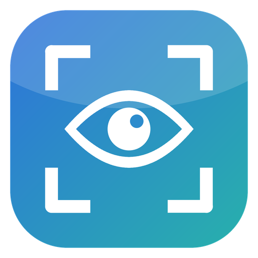
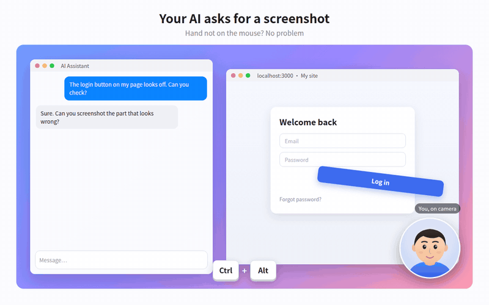

<p align="center"></p>

<h1 align="center">LookSnap</h1>

<p align="center">Turn your head to take a screenshot. No mouse, one hand.</p>

<p align="center"><b>English</b> · <a href="README.zh-CN.md">中文</a></p>

<p align="center"></p>

## What it does

Your laptop's trackpad is a pain, but you don't want to carry a mouse around. Taking a screenshot usually means pressing a shortcut, then clicking and dragging to set the area.

When you're chatting with an AI, though, a rough area is usually enough for it to understand. LookSnap is built for that: one shortcut, plus a turn of your head. The frame doesn't need to be precise, so it's quick.

1. Tap the shortcut (default `Ctrl + Alt`: press, then release). A frame appears where your nose is pointing.
2. Turn your head slightly and the frame glides that way. Face forward again and it stops.
3. Tap the shortcut again. What's inside the frame goes to your clipboard. Press `Ctrl + V` in any chat box.

## How it works

Your webcam and Google's open-source MediaPipe face model estimate which way your **head** is facing. It does not track your eyes: we tried webcam eye tracking first, and it was too jumpy to aim with. Head direction is much steadier.

Two things keep the frame steady:

- **Dead zone**: small head wobbles don't move the frame at all.
- **Joystick-style motion**: the frame doesn't jump to where you point. The further you turn, the faster it glides, so aiming is easy.

## Privacy

- Camera frames are processed on your computer only. Nothing is uploaded or saved.
- The camera is on only while the frame is shown, and turns off 20 seconds after use (you can keep it on in Settings).
- All code is open, so you can check for yourself.

## Download and use

Get it from [Releases](../../releases).

- **Windows**: download `LookSnap-Setup-x.x.x.exe` and double-click. It installs in a few seconds and opens by itself (no "Next" buttons, no admin rights). It then lives in the system tray as an eye icon; right-click it to quit. To uninstall, use Settings → Apps.
  - On first run Windows may show a blue "Windows protected your PC" screen. That's because this project doesn't pay for a Microsoft code-signing certificate, like most small open-source tools. Click "More info" → "Run anyway". If you'd rather not, read the source or build it yourself (below).
- **macOS (beta)**: `LookSnap-x.x.x-mac-arm64.dmg` (Apple silicon) or `LookSnap-x.x.x-mac-x64.dmg` (Intel). The author doesn't own a Mac, so it hasn't been tested on real hardware. Allow Camera, Screen Recording and Accessibility in System Settings → Privacy & Security. The app isn't notarized, so right-click → Open the first time.

The first launch asks you to look at 5 dots to calibrate (about 10 seconds). In Settings you can change:

- the shortcut
- which camera to use (defaults to the built-in one and skips phone/virtual cameras)
- dead-zone size and glide speed
- frame size (drag its corners)
- language: 中文 / English (follows your system language by default)

The right side of Settings is a live test area: try it with your head while you tune.

## Known limitations

- Detection gets worse in dim light, with a bright window behind you, or when your face is turned far to the side.
- With several screens, the frame appears on the screen where your mouse is.
- Auto-paste is experimental and off by default; some apps ignore simulated key presses.

## Build it yourself

```bash
npm install
npm start            # run in development
npm run dist:win     # build the Windows one-click installer
npm run dist:mac     # build the macOS dmg (on a Mac)
```

## License

MIT
