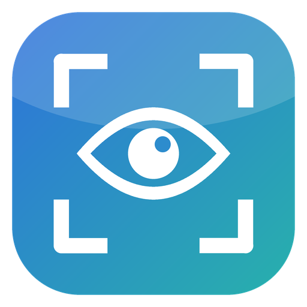

<p align="center"></p>

<h1 align="center">LookSnap 看哪截哪</h1>

<p align="center">转一下头就能截图。不用鼠标，一只手搞定。</p>

<p align="center"><a href="README.md">English</a> · <b>中文</b></p>

<p align="center"></p>

## 它是做什么的

跟 AI 聊天时，常常要截个图给它看：报错、页面哪里不对、哪块看不懂。可笔记本没接鼠标的时候，用触控板拖截图框挺麻烦。

LookSnap 让你转头来截图。框不用很准，大概圈住想给 AI 看的那块就行：

1. 按一下快捷键（默认 `Ctrl + Alt`，按下再松开），屏幕上出现一个框，位置就在你鼻子指的地方。
2. 头往哪边偏一点，框就往哪边慢慢挪；头回正，框就停。
3. 再按一下快捷键，框里的内容进剪贴板。在聊天框里按 `Ctrl + V` 粘贴即可。

## 工作原理

用电脑摄像头识别脸部（谷歌开源的 MediaPipe 面部模型），算出头朝哪个方向。它看的是**头的朝向**，不是眼球。我们试过纯眼球追踪：普通摄像头下误差太大、框一直跳，头的朝向要稳得多。

为了稳，做了两件事：

- **不动区**：头偏不到几度时，框完全不动，平时的小晃动不会带着框跑。
- **摇杆式移动**：框不是「头指哪就瞬移到哪」，而是头偏多少，框就以相应的速度慢慢挪，方便对准。

## 隐私

- 摄像头画面只在本机处理，不联网、不上传、不保存。
- 摄像头只在出框时打开，用完 20 秒自动关（可以在设置里改成常开）。
- 代码全部公开，可以自己检查。

## 下载和使用

到 [Releases](../../releases) 下载：

- **Windows**：下载 `LookSnap-Setup-x.x.x.exe`，双击后几秒自动装好并打开（不用点下一步，不需要管理员权限）。之后它待在右下角托盘，是一个眼睛图标，右键可以退出。不想用了，在「设置 → 应用」里卸载。
  - 第一次运行时，Windows 可能弹出蓝色的「Windows 已保护你的电脑」。这是因为本项目没有购买微软的代码签名证书，个人开源小工具大多如此。点「更多信息」→「仍要运行」即可。如果不放心，可以看源代码，或者按下面的方法自己构建。
- **macOS（测试版）**：`LookSnap-x.x.x-mac.dmg`。作者没有 Mac，没有实机测过。第一次打开要在「系统设置 → 隐私与安全性」里允许：摄像头、屏幕录制、辅助功能。因为没有付费的开发者签名，第一次要右键点「打开」。

第一次打开会请你做 5 个点的校准（约 10 秒）。设置页里可以改：

- 快捷键
- 用哪个摄像头（默认用电脑自带的，避开手机、虚拟摄像头）
- 不动区大小、移动速度
- 框的大小（可以直接拖）
- 中文 / English（默认跟随系统语言）

设置页右边可以直接用转头试，边试边调。

## 已知限制

- 光线太暗、背光、侧脸太多时，识别会变差。
- 多块屏幕时，框出现在鼠标所在的那块屏幕上。
- 自动粘贴是实验功能，默认关闭；部分软件可能收不到模拟的粘贴按键。

## 自己构建

```bash
npm install
npm start            # 开发运行
npm run dist:win     # 打包 Windows 一键安装包
npm run dist:mac     # 打包 macOS dmg（需要在 Mac 上）
```

## 许可

MIT
